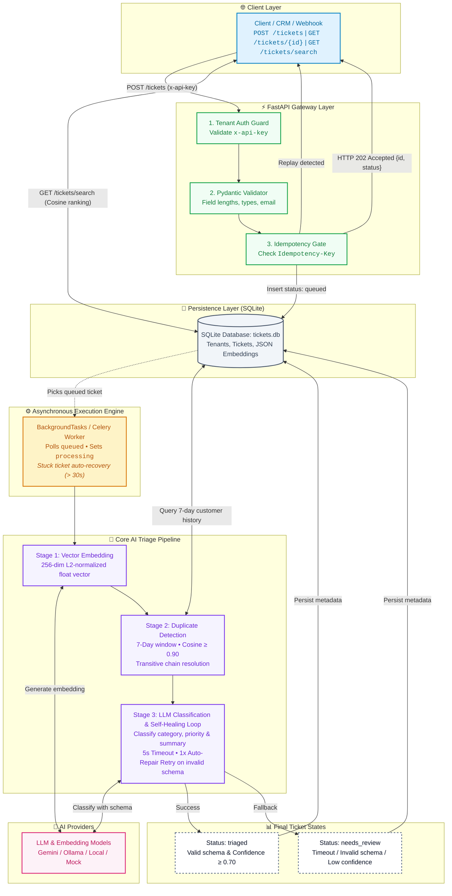

# AI Support Ticket Triage Service

A robust, multi-tenant backend service for AI-powered support-ticket triage built with **FastAPI**, **SQLite**, **Pydantic**, **Celery**, and **Pytest**.

The service handles incoming customer support requests, performs background triage using an LLM pipeline with an automatic schema repair loop, detects duplicates across a 7-day sliding window with chain resolution, and supports vector-based semantic search.

---

## 🚀 Key Features

- **Multi-Tenant Security**: Enforces tenant isolation on all operations via `x-api-key` authentication headers (`key_acme`, `key_beta`).
- **Async Queue & Processing**: Accepts incoming tickets with HTTP 202 (`queued`), offloading processing to asynchronous background tasks and Celery workers.
- **Resilient AI Triage Pipeline**:
  - Predicts ticket `category` (`billing`, `technical`, `account`, `feature_request`, `other`), `priority` (`urgent`, `high`, `low`), and generates a concise `summary`.
  - Self-healing repair loop: automatically triggers 1 retry on malformed model outputs before escalating to `needs_review` (`schema_invalid_after_repair`).
  - Graceful handling of timeouts (`timeout`) and low confidence outputs (`low_confidence`).
- **Duplicate Detection & Chain Resolution**:
  - Automatically compares incoming tickets with recent tickets from the same customer over a 7-day window using cosine similarity.
  - Matches $\ge 0.9$ similarity resolve transitively to the canonical root ticket (`duplicate_of`).
- **Semantic Vector Search**: Generates 256-dimensional L2-normalized embeddings to rank and return relevant tickets for any query string.
- **Idempotency Protection**: Optional `Idempotency-Key` header prevents duplicate ticket creation on network retries.
- **Background Worker Engine**:
  - Includes both an in-process asyncio worker and Celery distributed tasks.
  - Built-in crash recovery: automatically resets tickets stuck in `processing` (> 30s) back to `queued`.

---

## 🏛️ System Architecture

A single, clean, end-to-end architecture representing the complete lifecycle: from authenticated client ingestion, asynchronous queuing, and crash recovery, to vector duplicate resolution, self-healing LLM classification, and semantic vector search.



### Stage-by-Stage Processing Breakdown

| Stage | Responsibility | Failure & Fallback Handling |
| :--- | :--- | :--- |
| **Ingestion** | Enforces `x-api-key` tenant isolation, Pydantic field validation, and optional idempotency deduplication. Immediately returns HTTP 202 (`queued`). | HTTP 401 on missing/invalid key; HTTP 400 with granular field errors; cached ticket on duplicate `Idempotency-Key`. |
| **Worker Engine** | Pulls `queued` tickets, transitions status to `processing`. Includes periodic recovery resetting tickets stuck in `processing` > 30s back to `queued`. | Prevents lost tasks during worker restarts, crashes, or unhandled exceptions. |
| **Stage 1: Embedding** | Converts ticket `subject` + `body` into a 256-dimensional L2-normalized vector using configured provider (Gemini, Ollama, or Mock). | Fallback embedding providers configurable via `.env`. |
| **Stage 2: Duplicate Detection** | Scans tickets for the same `(tenant_id, customer_email)` within a 7-day sliding window. Calculates cosine similarity; if $\ge 0.90$, recursively resolves parent links to the canonical root ticket. | If no match $\ge 0.90$, ticket remains standalone (`duplicate_of: null`). Handles circular links with depth bounds. |
| **Stage 3: LLM Triage** | Invokes LLM with strict JSON schema instructions to classify `category`, assign `priority`, draft `summary`, and output `confidence`. | <ul><li>**Timeout**: 5s limit triggers fallback to `needs_review` (`timeout`).</li><li>**Invalid Schema**: 1x automatic repair retry with corrective prompt before fallback to `needs_review` (`schema_invalid_after_repair`).</li><li>**Low Confidence**: Confidence $< 0.70$ routes to `needs_review` (`low_confidence`).</li></ul> |
| **Stage 4: Persistence** | Atomically updates ticket record with triage results, raw embedding vector JSON, duplicate resolution, and attempt count. | SQLite row update within isolated tenant scope. |
| **Semantic Search** | Embeds incoming query `q`, computes cosine similarity against all triaged tenant tickets, and returns top-$K$ matches. | Input validation (2–200 chars, limit 1–20); tenant boundary strictly preserved. |

---

## 📁 Directory Structure

```text
.
├── .env                         # Environment variable configurations
├── .env.example                 # Example template for environment variables
├── README.md                    # Project documentation, instructions & trade-offs writeup
├── requirements.txt             # Python dependencies
├── IMPLEMENTATION_PLAN.md       # Step-by-step architecture & execution plan
│
├── src/
│   ├── app.py                   # FastAPI application setup & middleware/router mounting
│   ├── server.py                # Server startup script, DB initialization & background worker trigger
│   ├── config.py                # Pydantic BaseSettings management & Upstash Redis configuration
│   │
│   ├── routes/
│   │   ├── __init__.py
│   │   └── ticket_routes.py     # FastAPI routes: POST /tickets, GET /tickets/{id}, GET /tickets/search
│   │
│   ├── controllers/
│   │   ├── __init__.py
│   │   └── ticket_controller.py # Endpoint logic, Pydantic validation & response formatting
│   │
│   ├── services/
│   │   ├── __init__.py
│   │   ├── ticket_service.py    # Database operations & CRUD for tickets
│   │   ├── triage_service.py    # Core triage execution pipeline & repair loop
│   │   ├── embedding_service.py # Wrapper for text embedding generation
│   │   └── duplicate_service.py # Duplicate candidate query, cosine scoring & chain resolution
│   │
│   ├── providers/
│   │   ├── __init__.py
│   │   ├── llm_provider.py      # LLMProvider supporting configured providers (Gemini, Ollama)
│   │   └── embedding_provider.py# EmbeddingProvider supporting configured providers (Gemini, Ollama)
│   │
│   ├── workers/
│   │   ├── __init__.py
│   │   ├── celery_app.py        # Celery application initialization & broker configuration
│   │   ├── celery_worker.py     # Celery tasks: triage_ticket_task, recover_stuck_tickets_task
│   │   └── ticket_worker.py     # Async background worker loop & celery dispatch helper
│   │
│   ├── schemas/
│   │   ├── __init__.py
│   │   ├── ticket_schema.py     # Pydantic schemas for request validation (POST /tickets)
│   │   └── llm_output_schema.py # Pydantic schemas for runtime LLM output validation
│   │
│   ├── middleware/
│   │   ├── __init__.py
│   │   └── auth.py              # Tenant authentication dependency (x-api-key check)
│   │
│   ├── db/
│   │   ├── __init__.py
│   │   ├── database.py          # SQLite database connection manager
│   │   └── migrations.py        # SQLite schema initialization & tenant seeding
│   │
│   └── utils/
│       ├── __init__.py
│       ├── cosine.py            # Cosine similarity calculation helper
│       └── timeout.py           # Asyncio timeout wrapper helper (5s limit)
│
└── tests/
    ├── test_db.py               # Database migrations & connection tests
    ├── test_phase3.py           # Utilities, mock LLM, and embedder tests
    ├── test_phase4.py           # Schemas, validation rules, and auth tests
    ├── test_phase5.py           # Services, duplicate resolution & worker tests
    ├── test_phase6.py           # Controllers, routes & error formatting tests
    ├── test_celery.py           # Celery tasks & execution tests
    └── test_tickets.py          # Complete end-to-end integration test suite
```

---

## 🛠 Installation & Setup

### 1. Prerequisites
- Python 3.10+ (tested with Python 3.14)
- Pip / Virtual environment (recommended)

### 2. Install Dependencies
```bash
pip install -r requirements.txt
```

### 3. Environment Variables
Create a `.env` file from `.env.example`:
```bash
cp .env.example .env
```
Default configuration:
```env
DATABASE_PATH=tickets.db
DUPLICATE_THRESHOLD=0.9
LLM_TIMEOUT_SECONDS=5.0
LLM_PROVIDER=mock
EMBEDDING_PROVIDER=mock
HOST=0.0.0.0
PORT=8000
CONFIDENCE_THRESHOLD=0.7
STUCK_TIMEOUT_SECONDS=30.0
```

---

## 🖥 Running the Application

### 1. Start the FastAPI Server
```bash
python -m src.server
```
The server will initialize the SQLite schema, seed tenants (`acme`, `beta`), and start listening on `http://localhost:8000`.

Interactive Swagger documentation is available at:
👉 **`http://localhost:8000/docs`**

### 2. Run the Celery Worker (Optional)
If using Celery for distributed background processing:
```bash
celery -A src.workers.celery_worker.celery_app worker --loglevel=info -P solo
```
*(Note: `-P solo` is used on Windows to run tasks safely.)*

---

## 🧪 Running Tests

Execute the full suite of 72 automated tests:

```bash
python -m pytest
```

Run tests with detailed output:
```bash
python -m pytest -v
```

---

## 📡 API Reference & `curl` Examples

### Seed Tenants
| Tenant ID | Name | API Key |
| :--- | :--- | :--- |
| `acme` | Acme Corp | `key_acme` |
| `beta` | Beta Inc | `key_beta` |

---

### 1. Submit a Support Ticket (`POST /tickets`)
Returns **HTTP 202 Accepted** and queues background triage.

```bash
curl -X POST "http://localhost:8000/tickets" \
  -H "Content-Type: application/json" \
  -H "x-api-key: key_acme" \
  -H "Idempotency-Key: idemp-req-101" \
  -d '{
    "subject": "Cannot complete credit card payment for invoice",
    "body": "When I enter my billing details, the page returns error 402 payment required.",
    "customerEmail": "finance@client.com",
    "channel": "web"
  }'
```

**Response (202 Accepted):**
```json
{
  "id": "e2a5f576-9051-4f10-9b48-1ff4bb121287",
  "status": "queued"
}
```

---

### 2. Retrieve Ticket Details (`GET /tickets/{id}`)
Fetches ticket status and triage outcome (raw embedding array is omitted).

```bash
curl -X GET "http://localhost:8000/tickets/e2a5f576-9051-4f10-9b48-1ff4bb121287" \
  -H "x-api-key: key_acme"
```

**Response (200 OK):**
```json
{
  "id": "e2a5f576-9051-4f10-9b48-1ff4bb121287",
  "tenant_id": "acme",
  "idempotency_key": "idemp-req-101",
  "subject": "Cannot complete credit card payment for invoice",
  "body": "When I enter my billing details, the page returns error 402 payment required.",
  "customer_email": "finance@client.com",
  "channel": "web",
  "status": "triaged",
  "category": "billing",
  "priority": "low",
  "summary": "Summary: Cannot complete credit card payment for invoice",
  "confidence": 0.95,
  "triage_error": null,
  "llm_attempts": 1,
  "duplicate_of": null,
  "duplicate_score": null,
  "created_at": "2026-10-07 13:00:00",
  "updated_at": "2026-10-07 13:00:01"
}
```

---

### 3. Semantic Search (`GET /tickets/search`)
Ranks triaged tickets by cosine similarity against the query.

```bash
curl -X GET "http://localhost:8000/tickets/search?q=payment+invoice+error&limit=5" \
  -H "x-api-key: key_acme"
```

**Response (200 OK):**
```json
[
  {
    "id": "e2a5f576-9051-4f10-9b48-1ff4bb121287",
    "subject": "Cannot complete credit card payment for invoice",
    "body": "When I enter my billing details, the page returns error 402 payment required.",
    "category": "billing",
    "priority": "low",
    "status": "triaged",
    "created_at": "2026-10-07 13:00:00",
    "similarity": 0.9421
  }
]
```

---

### 4. Validation Error Example (HTTP 400 with Per-Field Details)
Submitting invalid fields or unknown parameters:

```bash
curl -X POST "http://localhost:8000/tickets" \
  -H "Content-Type: application/json" \
  -H "x-api-key: key_acme" \
  -d '{
    "subject": "Hi",
    "body": "Short",
    "customerEmail": "invalid-email",
    "unknownField": "not_allowed"
  }'
```

**Response (400 Bad Request):**
```json
{
  "error": "validation_error",
  "message": "Invalid request payload or parameters",
  "detail": [
    {
      "field": "subject",
      "message": "String should have at least 3 characters",
      "type": "string_too_short"
    },
    {
      "field": "body",
      "message": "String should have at least 10 characters",
      "type": "string_too_short"
    },
    {
      "field": "customerEmail",
      "message": "value is not a valid email address: ...",
      "type": "value_error"
    },
    {
      "field": "unknownField",
      "message": "Extra inputs are not permitted",
      "type": "extra_forbidden"
    }
  ]
}
```

---

### 5. Multi-Tenant Isolation Enforcement (HTTP 404)
When tenant `beta` attempts to access a ticket owned by `acme`:

```bash
curl -X GET "http://localhost:8000/tickets/e2a5f576-9051-4f10-9b48-1ff4bb121287" \
  -H "x-api-key: key_beta"
```

**Response (404 Not Found):**
```json
{
  "detail": "Ticket not found"
}
```

---

### 6. Authentication Failure (HTTP 401)
Request without `x-api-key` header:

```bash
curl -X GET "http://localhost:8000/tickets/some-id"
```

**Response (401 Unauthorized):**
```json
{
  "detail": "Missing API key"
}
```

---

## 🏗 Key Assumptions & Architectural Trade-offs at 1M Ticket Scale

### 1. Multi-Tenancy & Data Isolation
- **Current Approach**: Row-level tenant partitioning (`tenant_id` column with composite index on `(tenant_id, customer_email, created_at)`).
- **Scale Trade-off (1M+ Tickets)**:
  - Row-level multitenancy in a single SQLite file reaches locking limits (SQLite single-writer bottleneck).
  - *Recommendation at 1M Scale*: Migrate to **PostgreSQL with Schema-per-Tenant** or **Database-per-Tenant** for enterprise tiers, with Row-Level Security (RLS) enabled.

### 2. Semantic Search & Vector Embeddings
- **Current Approach**: 256-dimensional embeddings stored as JSON strings in SQLite, scored with Python in-memory brute-force cosine similarity.
- **Scale Trade-off (1M+ Tickets)**:
  - Scanning $10^6$ rows in Python consumes significant memory ($O(N)$ comparisons) and degrades response times ($>500\text{ms}$).
  - *Recommendation at 1M Scale*: Adopt a dedicated vector index such as **pgvector (HNSW / IVFFlat)**, **Qdrant**, or **Pinecone**. Approximate Nearest Neighbor (ANN) index reduces search latency to $<10\text{ms}$ with logarithmic $O(\log N)$ scaling.

### 3. Queueing & Background Workers
- **Current Approach**: Dual engine support—in-process `BackgroundTasks` alongside Celery with Redis broker and periodic stuck-processing recovery.
- **Scale Trade-off (1M+ Tickets)**:
  - In-process tasks are tied to the web worker process lifecycle and risk task loss during process restarts or crashes.
  - *Recommendation at 1M Scale*: Decouple fully with distributed message brokers like **Redis Streams**, **RabbitMQ**, or **Apache Kafka** with dead-letter queues (DLQ), consumer autoscaling (KEDA), and rate-limiting per tenant.

### 4. LLM Resilience & Rate Limiting
- **Current Approach**: Single-shot repair retry loop with 5-second timeout and fallback to `needs_review`.
- **Scale Trade-off (1M+ Tickets)**:
  - At high volume, external LLM providers enforce tight RPM/TPM rate limits and experience transient network latency.
  - *Recommendation at 1M Scale*: Implement an exponential backoff circuit breaker (e.g. `tenacity`), token-bucket rate limiter per tenant, and fallback to quantized local open-source models (e.g. Mistral/Llama via vLLM) for low-complexity tier classification.

### 5. Duplicate Detection & Windowing
- **Current Approach**: 7-day sliding window query on `(tenant_id, customer_email, created_at)`.
- **Scale Trade-off (1M+ Tickets)**:
  - High-frequency support customers generate large candidate lists over 7 days.
  - *Recommendation at 1M Scale*: Pre-filter candidate tickets by customer ID with a partition index and prune closed/resolved tickets older than 48 hours to minimize vector distance calculations.
